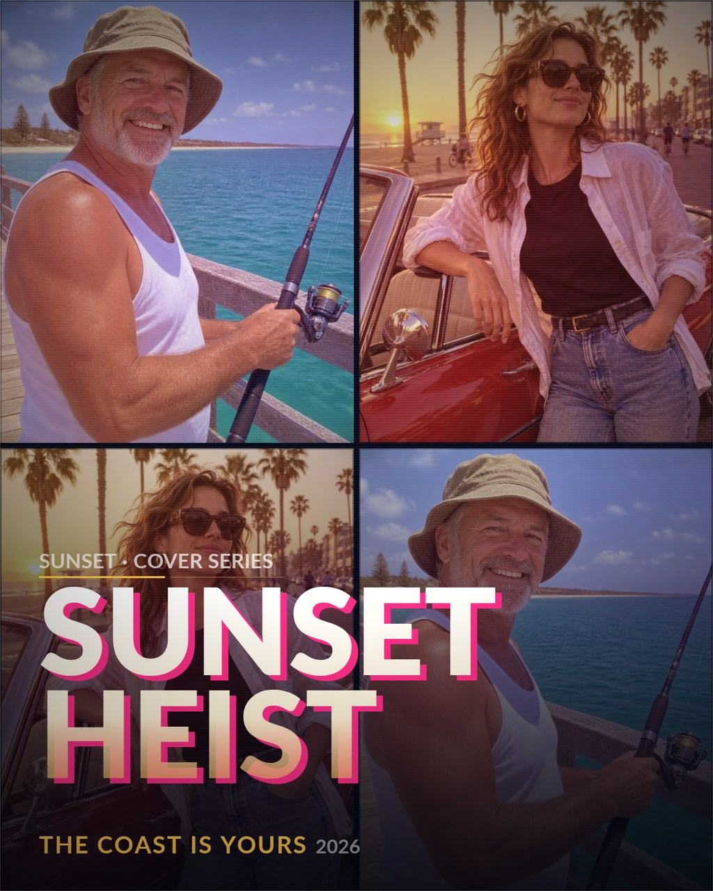
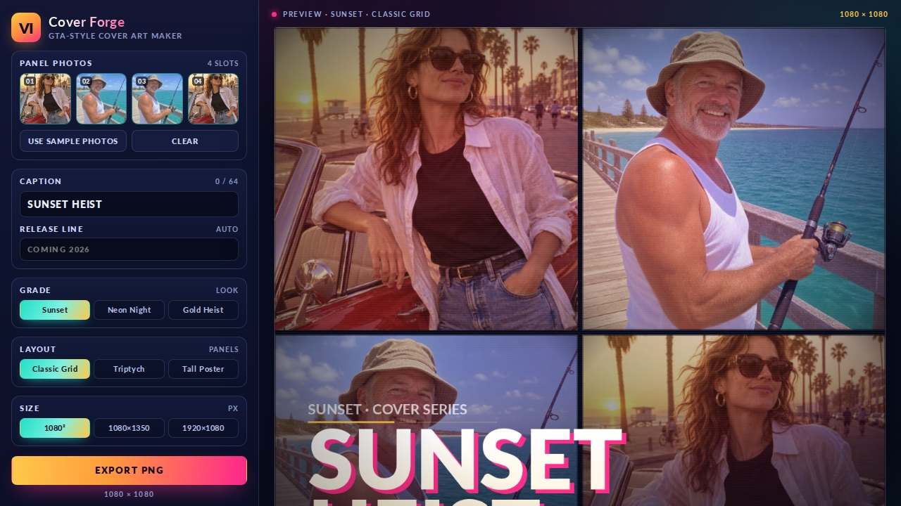
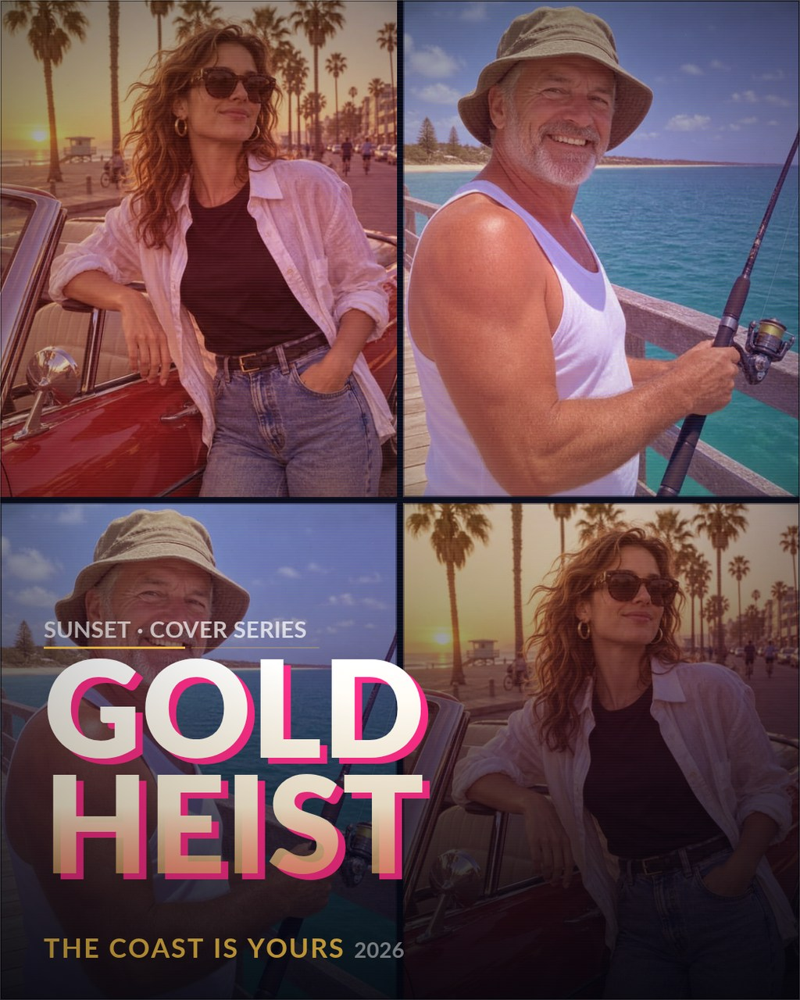

[](https://make.fun/bounty/gta6-cover-art-01)
[](https://make.fun/bounty/gta6-cover-art-01/leaderboard)
[](https://make.fun/bounty/gta6-cover-art-01)

# Cover Forge — a GTA 6-style cover art maker

Turn a photo and a caption into multi-panel poster cover art, right in the
browser. Four panel slots, a big all-caps caption block with the classic
offset-shadow treatment, three colour grades (**Sunset**, **Neon Night**,
**Gold Heist**), three panel layouts (**Classic Grid**, **Triptych**,
**Tall Poster**), and one-click PNG export at 1080×1080, 1080×1350 or
1920×1080.

Everything runs offline in desktop Chrome: no build step, no framework, no
network calls. Type is set in Lato (Black + Bold), loaded locally via
`FontFace`; photos never leave the browser — every pixel is painted on a
`<canvas>` with cover-fit crops (never distorted), per-grade colour grading
built from gradients and composite ops, film grain, a vignette and a 1px
inner border.

## Files

| File | What it is |
| --- | --- |
| `app/index.html` | Two-column editor: 4 panel slots, caption, grade / layout / size pickers, export button, live preview stage |
| `app/style.css` | Vice City palette (dusk navy, magenta, teal, gold), canvas that fits the viewport, `.shot-cover` cover-shot mode |
| `app/src/main.js` | State object, DOM wiring, rAF render loop, PNG export via `canvas.toBlob` |
| `app/src/cover.js` | The painter: `drawCover(canvas, state)` — panels, cover-fit crops, grade overlays, caption block, vignette |
| `app/src/shots.js` | `runShot(shot, query, load)` screenshot harness (`editor` / `cover` / `export`), sets `window.__shotReady` |
| `app/fonts/` | Lato Black + Bold (SIL OFL 1.1 — see `app/fonts/OFL-Lato.txt`) |
| `app/samples/` | Two sample photos (`pier.jpg`, `boulevard.jpg`) |
| `tools/shoot.py` | Playwright driver: serves the repo on `127.0.0.1:8099`, captures + verifies `screenshots/` |
| `main.ts` | Package step: copies `app/` + `screenshots/` to `$MAKEFUN_OUTPUT_DIR` (else `/output`) and writes `dossier.json` |
| `serve.ts` | Tiny static server for local dev on port `8080` |
| `screenshots/` | The generated submission shots (cover, editor, export) |

## Run it

```bash
# dev server on http://localhost:8080
node serve.ts

# rebuild the screenshots (needs Playwright + Pillow)
python3 tools/shoot.py

# produce the make.fun package (app/ + screenshots/ + dossier.json)
node --check app/src/*.js && node --check main.ts
MAKEFUN_OUTPUT_DIR=out node main.ts
```

The packaged dossier respects the make.fun caps: ≤ 163,840 bytes of text,
≤ 4 screenshots at ≤ 256 KiB each, ≤ 993 app files, ≤ 48 MiB total, and no
path over 1,000 bytes.

## Screenshots

| | |
| --- | --- |
|  |  |
|  | |

## License

Code: MIT (see `LICENSE`). Fonts: Lato, © Łukasz Dziedzic, SIL Open Font
License 1.1 (`app/fonts/OFL-Lato.txt`). Sample photos: free to use.
